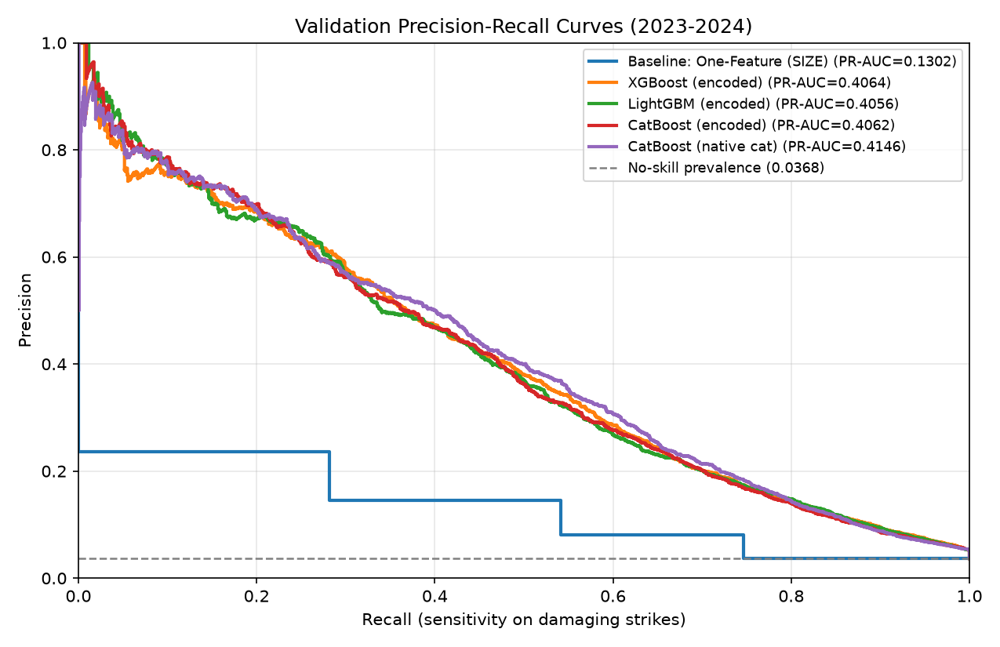
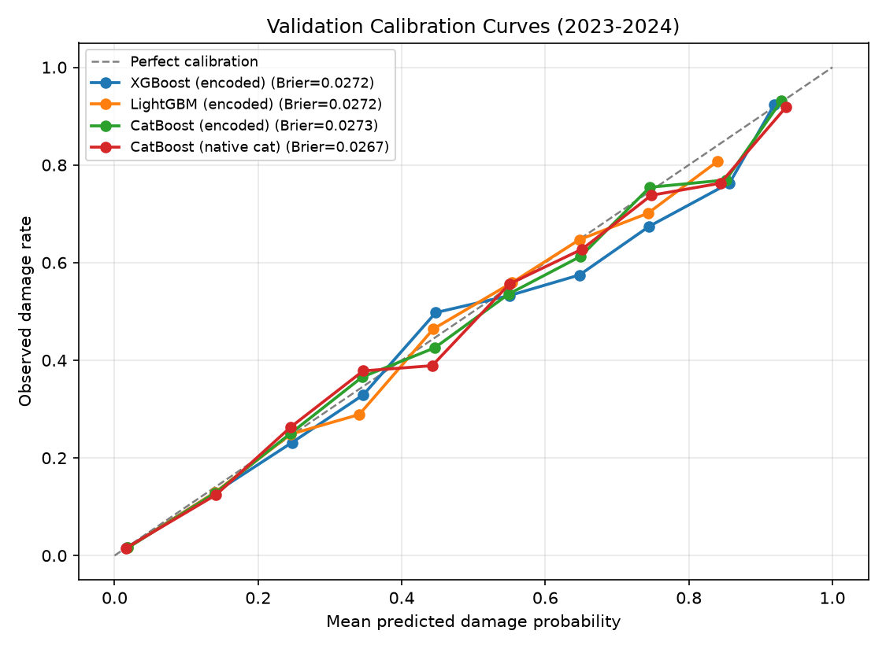

# Project Checkpoint Report (Phase 1–3)

**Title:** Predicting Damaging Aircraft Wildlife Strikes: A Cost-Sensitive Machine Learning Study of the FAA National Wildlife Strike Database  
**Course:** CS 6140 Machine Learning — Fall 2026  
**Team:** Mohammad Arshan Shaikh, Jay Alexander Rodriguez  
**Checkpoint Date:** November 22, 2026  

---

## 1. Problem & Dataset Overview

We predict whether a reported aircraft–wildlife strike damages the aircraft (`INDICATED_DAMAGE = 1`) using **only information available at or before the moment of impact**. Because missing a damaging strike is far costlier than an unnecessary precaution, our primary evaluation metric is **PR-AUC** (average precision on the minority damage class), alongside ROC-AUC, Recall at fixed precision operating points, F1, and Brier score for probability calibration.

- **Source:** Official FAA National Wildlife Strike Database (`data/raw/Public.xlsx`, cached to `data/processed/strikes_v2.parquet` via `src/data_loading.py`).
- **Size:** `361,264` strike records × `102` columns (1990–2026).
- **Overall target prevalence:** `22,369` damaging strikes (**6.192%** overall).
- **Voluntary reporting caveat:** Because FAA wildlife strike reporting is voluntary and damaging events are more likely to be reported, our models estimate $P(\text{damage} \mid \text{reported strike})$ rather than the unconditional strike damage rate.

---

## 2. Leakage Audit & Feature Selection

Every one of the 102 columns was audited in `src/data_loading.py` using a fail-closed classification (`python -m src.run_audit`):

| Group | Treatment | Examples / Rationale |
|---|---|---|
| **Post-strike leakage** | Dropped | `COST_REPAIRS*`, `AOS`, `EFFECT*`, `DAM_*`, `ING_*`, `NR_INJURIES`, `NR_FATALITIES`, `REMAINS_*`, `OTHER_SPECIFY` |
| **Target sources** | Used for label only | `INDICATED_DAMAGE`, `DAMAGE_LEVEL` (zero missing values in `INDICATED_DAMAGE`) |
| **Identifiers / free text / admin** | Dropped | `INDEX_NR`, `REG`, `FLT`, `REMARKS`, `COMMENTS`, `REPORTED_*`, `LUPDATE` |
| **Redundant / structurally empty** | Dropped | `ENG_3_POS`, `ENG_4_POS`, `AIRPORT` (dup of `AIRPORT_ID`), `OPERATOR` (dup of `OPID`), `SPECIES_ID` (dup of `SPECIES`), `ENROUTE_STATE`, `LOCATION` |
| **Borderline (at/just after impact)** | Dropped by default | `NUM_STRUCK`, `NUM_SEEN`, `STR_*` (reserved for sensitivity check) |
| **Split only** | Never a feature | `INCIDENT_DATE`, `INCIDENT_YEAR` |
| **Kept pre-impact features** | **30 features** | Temporal (`INCIDENT_MONTH`, `TIME`, `TIME_OF_DAY`), Airport/Location (`AIRPORT_ID`, `LATITUDE`, `LONGITUDE`, `RUNWAY`, `STATE`, `FAAREGION`), Aircraft/Engine (`OPID`, `AIRCRAFT`, `AMA`, `AMO`, `EMA`, `EMO`, `AC_CLASS`, `AC_MASS`, `TYPE_ENG`, `NUM_ENGS`, `ENG_1_POS`, `ENG_2_POS`), Flight/Weather/Wildlife (`PHASE_OF_FLIGHT`, `HEIGHT`, `SPEED`, `DISTANCE`, `SKY`, `PRECIPITATION`, `SPECIES`, `SIZE`, `WARNED`) |

---

## 3. Key Exploratory Data Analysis (EDA) Findings

Full EDA tables and figures are reproducible via `python -m src.eda` (`reports/figures/`). Four findings directly shaped our modeling pipeline:

1. **Reporting regime shift over time (`reports/figures/damage_by_year.png`, `blank_share_by_year.png`):**  
   Annual reported strikes rose more than 10× from `2,121` in 1990 (17.5% damage rate) to `24,457` in 2025 (3.70% damage rate) as reporting of non-damaging strikes improved. From **2014 onward**, the damage rate stabilized around `3.7%–4.6%`. The partial year `2026` (`17,692` rows, 3.06%) is excluded from all splits.
2. **Missingness is strongly informative (not missing at random):**  
   Across key flight and aircraft fields, blank entries have systematically different damage rates than present entries:
   - `AC_MASS`: blank (`28.4%` of rows) → **0.19%** damage vs. present → **8.57%**
   - `PHASE_OF_FLIGHT`: blank (`39.6%`) → **1.88%** vs. present → **9.03%**
   - `HEIGHT`: blank (`50.6%`) → **3.03%** vs. present → **9.44%**
   - `SPEED`: blank (`69.4%`) → **3.96%** vs. present → **11.24%**
   - `DISTANCE`: blank (`33.6%`) → **9.68%** vs. present → **4.42%** (opposite direction!)
3. **Species size is a dominant single driver (`reports/figures/damage_by_size.png`):**  
   Across all years, `Large` species cause damage in **32.3%** of strikes (`n = 21,229`), `Medium` in **12.6%** (`n = 74,353`), `(blank)` in **4.2%** (`n = 43,209`), and `Small` in **2.0%** (`n = 222,473`).
4. **Phase of flight, height, and speed (`damage_by_phase_of_flight.png`, `damage_by_height_bin.png`, `damage_by_speed_bin.png`):**  
   Damage risk is highest `En Route` (**29.1%**, `n = 6,499`), `Climb` (**14.2%**, `n = 31,774`), and `Descent` (**13.8%**, `n = 3,139`), compared to `Approach` (**8.4%**) and `Landing Roll` (**5.4%**).

---

## 4. Time-Aware Split & Preprocessing Strategy

To prevent temporal leakage and evaluate on the stable modern reporting regime (`src/splits.py`), we use the **`main`** chronological split:

| Split | Years | Rows (`n`) | Damaging | Damage Rate (No-Skill PR-AUC) |
|---|---|---:|---:|---:|
| **Train** | 2014–2022 | 133,644 | 5,852 | 4.38% |
| **Validation** | 2023–2024 | 41,993 | 1,545 | 3.68% |
| **Test (held out)** | 2025 | 24,457 | 905 | 3.70% |
| Excluded | 1990–2013 & partial 2026 | 161,170 | 14,067 | 8.73% |

- **Strict split discipline:** All preprocessing transformers and models are fitted on `train` (2014–2022) only, evaluated and compared on `validation` (2023–2024), and `test` (2025) remains untouched until Phase 6 final evaluation.
- **Preprocessing (`src/preprocessing.py`):** Stateless feature engineering adds `TIME_HOUR` (parsed from `TIME`) and `species_unknown`. `ColumnTransformer` median-imputes numeric features with missingness indicators (`8` indicator columns), one-hot encodes low-cardinality categoricals (`min_frequency=200`, keeping `"(blank)"` as a category), and frequency-encodes the 9 high-cardinality ID columns (`AIRPORT_ID`, `OPID`, `AIRCRAFT`, `AMA`, `AMO`, `EMA`, `EMO`, `SPECIES`, `RUNWAY`), yielding **146 features** (`127` without missing indicators) and zero NaNs.

---

## 5. Preliminary Modeling Results (Validation Set: 2023–2024)

Reproducible via `python -m src.baselines` and `python -m src.boosting`. All first gradient-boosting runs are **unweighted** (preserving native probability calibration) with early stopping (`50` rounds) on validation PR-AUC.

| Model | Owner | PR-AUC (Primary) | ROC-AUC | Brier | Recall @ P≥20% | Recall @ P≥30% | Recall @ P≥50% | F1 @ 0.50 | Best Val F1 | Train Time (s) |
|---|---|---:|---:|---:|---:|---:|---:|---:|---:|---:|
| Baseline: Majority / Prior | Jay | 0.0368 | 0.5000 | 0.0355 | 0.0000 | 0.0000 | 0.0000 | 0.0000 | 0.0710 | 0.00 |
| Baseline: One-Feature (`SIZE`) | Jay | 0.1302 | 0.7617 | 0.0330 | 0.2816 | 0.0000 | 0.0000 | 0.0000 | 0.2566 | 0.02 |
| Logistic Regression (Elastic-Net) | Arshan | *[TBD — Arshan]* | — | — | — | — | — | — | — | — |
| Random Forest | Arshan | *[TBD — Arshan]* | — | — | — | — | — | — | — | — |
| XGBoost (encoded, w/ missing ind.) | Jay | 0.4064 | **0.8979** | 0.0271 | 0.7036 | 0.5832 | 0.3689 | 0.3365 | 0.4390 | 3.31 |
| LightGBM (encoded, w/ missing ind.) | Jay | 0.4056 | 0.8962 | 0.0272 | 0.7016 | 0.5670 | 0.3405 | **0.3399** | 0.4375 | **2.14** |
| CatBoost (encoded, w/ missing ind.) | Jay | 0.4062 | 0.8925 | 0.0272 | 0.7023 | 0.5676 | 0.3709 | 0.3290 | 0.4398 | 12.02 |
| **CatBoost (native categoricals)** | Jay | **0.4146** | 0.8953 | **0.0268** | **0.7204** | **0.6091** | **0.4013** | 0.3330 | **0.4504** | 45.04 |
| *Ablation:* XGBoost (no missing ind.) | Jay | 0.4013 | 0.8959 | 0.0273 | 0.6945 | 0.5780 | 0.3573 | 0.3304 | 0.4406 | 4.25 |
| *Ablation:* LightGBM (no missing ind.) | Jay | 0.3971 | 0.8929 | 0.0274 | 0.6906 | 0.5728 | 0.3605 | 0.3269 | 0.4342 | 1.81 |

### Validation Diagnostic Figures

### Key Takeaways from First Runs
1. **Substantial lift over baselines:** All four boosting runs exceed **0.405 PR-AUC** (>11× lift over the 0.0368 no-skill prevalence and >3.1× lift over the 0.1302 one-feature `SIZE` rule) and reach **~0.895–0.898 ROC-AUC**.
2. **Native high-cardinality categoricals help (RQ1):** On the shared encoded matrix, XGBoost (`0.4064`), LightGBM (`0.4056`), and CatBoost (`0.4062`) perform nearly identically. Allowing CatBoost to use the 9 high-cardinality categorical columns (`AIRCRAFT`, `SPECIES`, `AMA`, `OPID`, `AIRPORT_ID`, etc.) natively raises PR-AUC to **`0.4146`** (+0.0084), improves Brier score to **`0.0268`**, and lifts Recall @ Precision ≥ 50% from ~37% to **40.1%** (at the cost of ~45s vs. 2–3s training time).
3. **Missingness indicators matter:** Removing missingness indicators drops PR-AUC for both XGBoost (`0.4064 → 0.4013`) and LightGBM (`0.4056 → 0.3971`), confirming our EDA hypothesis that blank fields carry genuine predictive signal.
4. **Strong raw calibration & threshold sensitivity (RQ3 preview):** Unweighted boosting probabilities already align closely with observed damage rates across the full `[0, 1]` range (calibration plot above). However, using a naive `0.50` decision threshold yields F1 ≈ `0.33–0.34`, whereas lowering the threshold lifts F1 to `0.44–0.45` and catches **72.0%** of damaging strikes at ≥20% precision — directly motivating our Phase 6 cost-sensitive threshold analysis.

---

## 6. Next Steps (Phases 4–6)

- **Arshan (Phases 3–6):** Merge Logistic Regression and Random Forest results into Section 5; build tabular MLP with categorical embeddings (Phase 4); tune LR/RF/NN (Phase 5); run calibration (Platt/isotonic) and slice analysis by phase of flight, species size, and region (Phase 6).
- **Jay (Phases 4–6):** Set up Optuna/time-series CV hyperparameter tuning for XGBoost, LightGBM, and CatBoost (including testing `all_years` vs. `main` training window and native categorical support in LightGBM/XGBoost) (Phases 4–5); run SHAP & permutation importance (RQ2) and cost-sensitive threshold curves for 3:1–10:1 cost ratios (RQ3) (Phase 6).
- **Final Test Evaluation:** Freeze models and evaluate once on the held-out `2025` test set (`n = 24,457`) in Phase 6.
